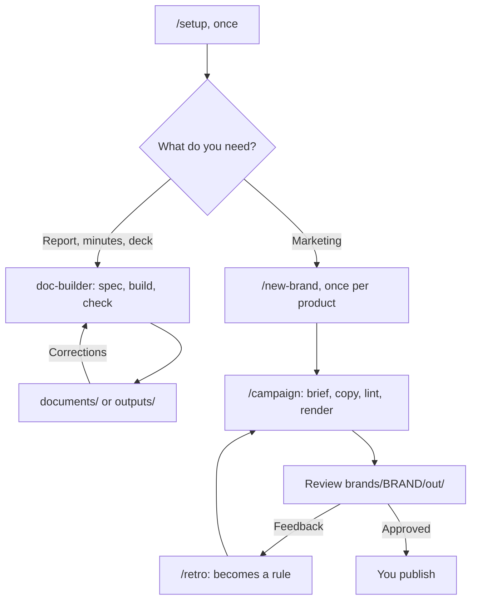

# Work agent kit

A workspace for [Claude Code](https://claude.com/claude-code) (and partly GitHub Copilot) that helps with
two kinds of work:

- **Project management**: weekly/monthly reports, minutes of meeting, branded slide decks and Word
  documents, Jira, email follow-up.
- **Marketing**: product videos and images rendered from code, per-brand voice rules, an anti-slop linter,
  and a feedback loop that turns your comments into rules.

Nothing in here belongs to one company. Your context, templates and client material stay in files that git ignores.

## What it can do

### Project management

| You give | You get | Where |
|---|---|---|
| Notes for a week or month | Report as slides (.pptx) or Word (.docx) in your template | Claude Code |
| Meeting notes | Minutes with decisions, action items, owners and deadlines | Claude Code (Word), Copilot (Markdown) |
| A plan or evaluation | A deck with tables, flows, icons, images and speaker notes | Claude Code |
| A topic, audience and duration | Slide-by-slide outline with speaker notes | Copilot |
| Access to your Jira | Team workload, blockers, reports from Jira data, issues created or updated after you confirm | Copilot + Atlassian MCP server |
| Pasted email | Prioritized follow-up list and draft replies | Copilot |
| Sample reports, videos or images you like | Summaries and rules that later work follows | Claude Code |

### Marketing (Claude Code)

| You give | You get |
|---|---|
| A product and its docs | A brand folder: voice, provable claims, banned words, colors, logos |
| Demo footage and a message | TikTok/Reels/Shorts video with captions, landing-page loop, square video, poster images |
| A message or screenshots | Product tour video, social post, link card (OG), cover image |
| A product repo | Content ideas from new features and changelog entries |
| A reference video | Cuts, hook frames, shots and transcript, to learn structure and pacing from |
| A mood and a length | Background music generated by code |
| Your feedback | Rules the next campaign follows; banned words go into the linter |

### What it does not do

- Send email, post to a channel or change your product's repo. You review and publish.
- Generate images, people or UI with AI. Visuals come from real footage, screenshots and code.
- Invent metrics or ticket numbers. A report lists what the agent added so you can check it.
- Edit an existing .pptx or .docx in place. It builds a new file in your template.

## Start

1. Install what you need:

   | Tool | For |
   |---|---|
   | [Claude Code](https://claude.com/claude-code) | the agents and skills |
   | [uv](https://docs.astral.sh/uv/) | decks, documents and the Python tools |
   | Node.js, [pnpm](https://pnpm.io) and ffmpeg | video and images |
   | LibreOffice (optional) | checking decks and documents visually |

2. Clone the repo, open it in Claude Code and run `/setup`. It writes `profile.md` (who you are, language,
   preferences) and, if you want, a theme with your colors or your company's template.
3. Try it:

   ```sh
   uv run tools/docs/build_deck.py tools/docs/examples/weekly-report-deck.json
   uv run tools/docs/build_doc.py  tools/docs/examples/weekly-report-doc.json

   cd video && pnpm install && cd ..
   tools/render.sh example hello
   ```

On Windows run the `.sh` tools from Git Bash.

## How to use it

Run `/setup` once. After that, ask in plain language or use a command.



### Report, minutes or deck

1. In Claude Code, paste your notes and say the period, the audience and the format:

   > Make the weekly report for 16–20 November as slides for the head of delivery. Notes: …

   > Write the minutes of this meeting as Word: …

2. The `doc-builder` agent writes a spec, builds the file in your template and fixes text that does not fit.
3. Read its "added by me, please verify" list and say what to change: "Move item 3 to next week."
4. Take the file from `documents/` (decks) or `outputs/` (Word).

### Marketing content

1. **Once per product:** `/new-brand <brand> [path to the product repo]`. Answer its questions and put demo
   videos in `brands/<brand>/footage/`.
2. **Find an idea** (optional): `/content-radar <brand>`.
3. **Make it:** `/campaign <brand> tiktok about search filters`. The `marketer` agent writes a brief with
   proof for each claim, writes and lints the copy, renders, and checks the frames. For a new campaign it
   shows you the copy before rendering.
4. **Review** the files in `brands/<brand>/out/<campaign>/`.
5. **Give feedback:** `/retro <brand>`, for example "captions too fast, never say platform". It becomes a rule.
6. **Publish** it yourself. Give the views or clicks to `/retro` later; they go in `playbook/results.md`.

Run `/refresh` about once a month to update the channel and tool notes in `playbook/`.

### Learn from your references

1. Put samples in `references/raw/` (not in git): reports, decks, `videos/<topic>/`, `images/<topic>/`.
2. Say "process new references". Summaries go to `references/distilled/`.
3. Later jobs read the summaries instead of the originals. Corrections are kept there too: "Remember: no
   budget figures in weekly reports."

### Jira and email, with GitHub Copilot

1. Open the repo in VS Code with GitHub Copilot and connect the Atlassian MCP server. Copy `.env.example` to
   `.env` and fill in your Jira project.
2. In Copilot Chat, run a prompt, or choose the PM Assistant agent and describe the task:

   | Prompt | For |
   |---|---|
   | `/team-monitor` | workload, blockers and overdue issues (read only) |
   | `/report-writer` | weekly or monthly report from Jira data |
   | `/mom-writer` | minutes of meeting in Markdown |
   | `/jira-manager` | find, create and update issues |
   | `/presentation-builder` | outline and slide text |
   | `/email-followup` | follow-up list from pasted email |

3. Every write to Jira shows a preview and waits for your "yes".

### Claude Code commands

| Command | Does |
|---|---|
| `/setup` | profile, theme and tool check; run it again to change them |
| `/new-brand <brand> [repo path]` | adds a product with its own voice, colors and rules |
| `/campaign <brand> <what>` | brief, copy, specs and renders |
| `/content-radar <brand>` | content ideas from product changes |
| `/retro <brand> [campaign]` | turns feedback into rules |
| `/refresh [focus]` | updates `playbook/`; focus is `channels`, `tactics`, `tools` or a platform name |

On Linux, `/content-radar` and `/refresh` can also run on a schedule; see `CLAUDE.md`.

## Optional: Lumbung

You do not need [Lumbung](https://github.com/mahrus-rohisyam/lumbung-agent) to use this workspace; its own
agents and skills are all in this repo. Lumbung is a Claude Code plugin with shared reviewers, and three of them fill gaps here:

| Lumbung | Useful here for |
|---|---|
| `lumbung:no-ai-slop` | Reports, minutes and email. `tools/slop_check.py` is for marketing copy. |
| `lumbung:slop-reviewer` | Reviewing your changes to prompts, docs and the code in `video/` |
| `lumbung:dependency-auditor` | Checking an npm package before you add or bump it in `video/` |

Install it if you change this workspace or want a second check on your writing. Skip it if you only make
documents and campaigns. In Claude Code:

```
/plugin marketplace add https://github.com/mahrus-rohisyam/lumbung-agent.git
/plugin install lumbung@lumbung-agent
```

Before you install it:

- It loads its author's rules into every session, including the paths of their machines. To use your own,
  fork it and change `rules/rules.md` and `REGISTRY.md`.
- It blocks a new agent that looks like one it knows. To keep yours, add `# lumbung-override: <reason>` to its
  frontmatter, as `.claude/agents/marketer.md` does.
- It logs subagent runs (agent, folder, time, computer name) to a file on your machine. The log and the block
  need Python 3.8+; without it the agents and skills still work.

## What stays private

Git ignores `profile.md`, `.env`, `templates/theme.local.json`, `templates/private/`, `documents/`,
`outputs/`, `reports/`, `moms/`, `references/raw/`, `tools/docs/specs/` and `brands/*/footage/`.
`brands/<your brand>/` and `references/distilled/` **are** tracked: keep your copy private if they hold
anything confidential.

## More

- `CLAUDE.md`: layout, rules and commands
- `tools/docs/README.md`: deck, document and theme formats
- `ANTI-SLOP.md`: quality rules for marketing content

## License

MIT, see `LICENSE`. Third parties: Inter is under the SIL Open Font License
(`video/public/fonts/Inter-LICENSE.txt`). Remotion has its
[own license](https://www.remotion.dev/license): free for individuals and companies of up to 3 people.
